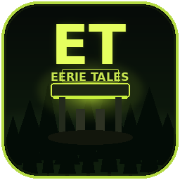

# EERIE TALES

Episode 1: Eerie Springs Gas, a first-person night-shift horror game.

Night shift at a rural Appalachian gas station. You do not need Godot installed.

## Download & Install

1. Click [`EERIE_TALES_Setup.exe`](EERIE_TALES_Setup.exe) in the file list, then click the **Download raw file** button.
2. Run `EERIE_TALES_Setup.exe`.
3. If Windows SmartScreen appears ("Windows protected your PC"), click **More info**, then **Run anyway**. The installer is unsigned, which is normal for indie builds.
4. Finish the wizard. It creates an **EERIE TALES** desktop icon (and a Start Menu entry).
5. Double-click the desktop icon to play.

## Controls

| Key | Action |
| --- | --- |
| WASD | Move |
| Mouse | Look |
| E | Interact |
| F | Flashlight |
| Left click | Scan item (at the register) |
| Tab | Show / hide chore list |
| H | Toggle onboarding hints |
| Esc | Pause / settings |
| T | Debug time scale (testing) |

## Uninstall

Use **Add or remove programs** in Windows Settings, or open **Start Menu → EERIE TALES → Uninstall EERIE TALES**.

## System

Windows 10/11 64-bit recommended. Built with Godot 4.7.2 (Forward+). Uses Direct3D 12 / Vulkan with an OpenGL fallback.
